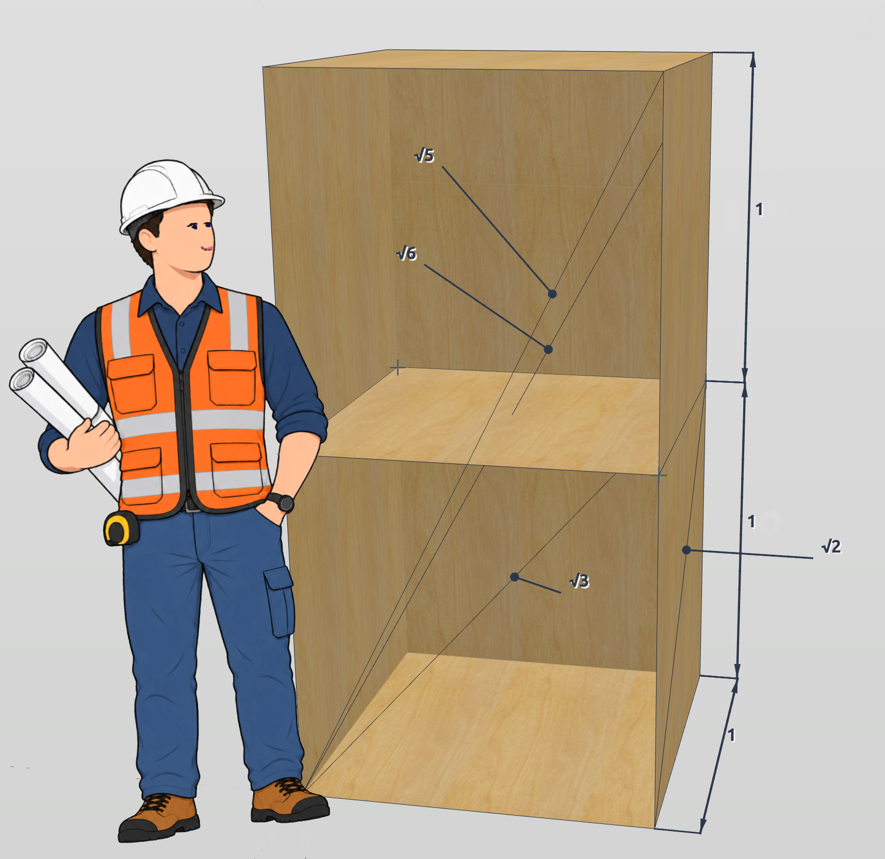

## La rompita mezurilo

Metiisto iam devis elmezuri ŝrankon. Li konstatis ke la ŝranko estis larĝa kaj profunda unu metron kaj alta du metrojn. En la mezo la ŝranko havis breton, kiu dividis ĝin en du fakojn. Kiam li volis ankoraŭ mezuri la diagonalojn, lia mezurilo rompiĝis.... Li pripensis iom kion fari kaj fine trovis elturnon. Li notis tion por la diagonaloj: $$\sqrt 2$$, $$\sqrt 3$$, $$\sqrt 5$$, $$\sqrt 6$$.

Kion li celis esprimi? Nu proksimume tion: "*mia mezurilo rompiĝis, sed la kvadrato de la malgranda diagonalo...*", (t.e la mezuro multiplikita per si mem) "*...devas esti 2, de la granda diagonalo en unu fako 3, tra la tuta ŝranko antaŭe 5 kaj de la malsupra antaŭa angulo al la supra malantaŭa eĉ 6*".

La simbolo √, kiu aspektas kiel rompita mezurilo fakte simbolas literon "r", kaj efektive ne signfas *rompita*, sed *radiko*.

## La kvadrato el la diagonalo

Sed kiel li povas scii, ke la longo de la diagonalo ĉe tabulo $$1m \times 1m$$ havas la longon, kies kvadrato estas 2? Nu, ni
rigardu la sekvan desegnon: la blua kvadrato estas la tabulo kun flankoj longaj je 1m, kaj la ruĝa kvadrato havas
flankojn longaj laŭ ĝia diagonalo. Kiel oni vidas, eblas meti la triangulan duonon de la blua kvadrato kvarfoje en
la ruĝan kvadraton. Ni scias, ke la malgranda kvadrato havas areon $$1m \cdot 1m = 1m^2$$ kaj sekve la ruĝa kvadrato
devas havi la duoblan areon, tio estas $$2m^2$$. Kaj el tio ni scias, ke la longo de ĝia flanko multiplikita per si mem
rezultas en 2.

<svg xmlns="http://www.w3.org/2000/svg" viewBox="-2 -2 204 204" width="50%" height="50%">
  

  <!-- fono -->
  <!--rect width="100%" height="100%" fill="#ffffff" / -->

  <!-- kvadrato 100 x 100 cm -->
  <rect x="0" y="100" width="100" height="100" class="tabulo" />

  <!-- kvadrato kun unu flanko estanta la diagonalo de la kvadrato 100x100 -->
  <polygon points="0,100 100,200 200,100 100,0" class="diagonalo" />

  <!-- tekstoj -->
  <text x="5" y="155" class="tabulo_teksto">areo = 1 m²</text>
  <text x="35" y="215" class="tabulo_teksto">1 m</text>

  <text x="60" y="90" class="diagonalo_teksto">areo = 2 m²</text>
  <text x="140" y="180" class="diagonalo_teksto" transform="rotate(-45, 140, 180)">√2 m</text>
</svg>

## La babilona metodo

Nu, "*bele, bele*", vi certe diras, sed la ja mezurilo estas ankoraŭ rompita,
kaj ni ankoraŭ ne scias kiel longa estas la diagonalo. Sed feliĉe la sciencistoj de Babilono jam
antaŭ pli ol tri mil jaroj eltrovis metodon kiel *eltiri* la radikon el areo de kvadrato.

Ni komencas per rektangulo kun areo de $$A=1m \cdot 2m = 2m^2$$ kaj premas ĝin tiom longe ĝis ĝi estas
kvadrato:

<svg xmlns="http://www.w3.org/2000/svg" viewBox="-2 -2 204 204" width="50%" height="50%">
  

  <!-- fono -->
  <!--rect width="100%" height="100%" fill="#ffffff" / -->

  <!-- kvadrato 141 x 141 cm -->
  <rect x="0" y="59" width="141" height="141" class="kvadrato" />

  <!-- rektangulo 100 x 200 -->
  <polygon points="0,200 100,200 100,0 0,0" class="verda" />

  <!-- tekstoj -->
  <text x="25" y="45" class="verda_teksto">A = 2 m²</text>
  <text x="20" y="195" class="verda_teksto">x₀ = 1 m</text>
  <text x="10" y="80" class="verda_teksto" transform="rotate(90, 10, 80)">y₀ = 2 m</text>

  <text x="55" y="155" class="ruĝa_teksto" transform="rotate(-45, 55, 155)">A = 2 m²</text>
</svg>

Por tio ni donas al unu flanko la mezvaloron inter longa kaj mallonga flankoj:

$${\displaystyle x_{1}={\frac {x_{0}+y_{0}}{2}}}$$

kaj per la areo elkalkulas la longon de la alia flanko:

$${\displaystyle y_{1}={\frac {A}{x_{1}}}}$$

Tion ni ripetas, ĝis ambaŭ flankoj estas pli malpli samlongaj kaj havas do la longon de
nia serĉata diagonalo.

<!-- Pitagoro, Herono -->
